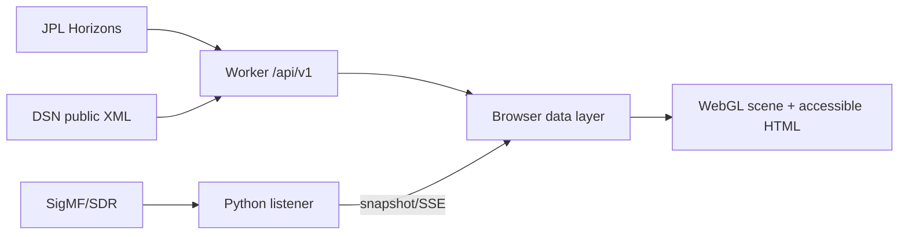

# Architecture

The product has four trust zones: public NASA/JPL upstreams, the Cloudflare Worker, the browser, and an operator-controlled listener. The Worker normalizes only fixed upstream URLs; it is not an open proxy. The listener binds to loopback by default.

Absolute astronomical coordinates remain data values. Rendering uses a local floating-origin frame with Voyager at the origin and compressed path control points. `shared/contracts.js` is the versioned JavaScript contract; the Python snapshot module emits the same field names and is covered by contract tests. Static assets are served by the Worker ASSETS binding; `/api/*` runs Worker-first.

Degraded states are first-class: Horizons falls back to `STALE`, DSN to `UNAVAILABLE`, authentic recording to unavailable, and WebGL to an SVG/text representation. No degraded state becomes `LIVE`.
