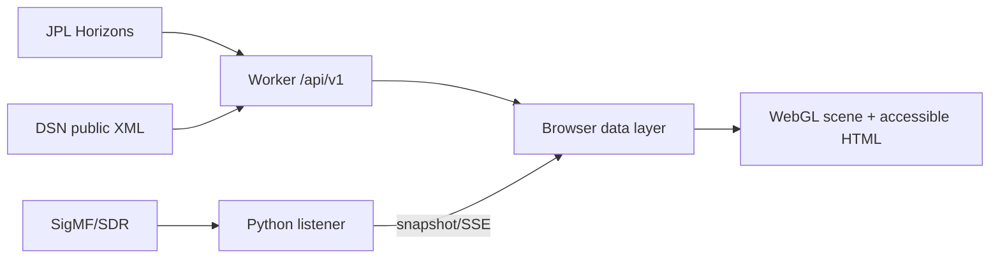

# Architecture

The product has four trust zones: public NASA/JPL upstreams, the Cloudflare Worker, the browser, and an operator-controlled listener. The Worker normalizes only fixed upstream URLs; it is not an open proxy. The listener binds to loopback by default.

Absolute astronomical coordinates remain data values. Rendering uses a local floating-origin frame with Voyager at the origin and compressed path control points. `shared/contracts.js` is the versioned JavaScript contract; the Python snapshot module emits the same field names and is covered by contract tests. Static assets are served by the Worker ASSETS binding; `/api/*` runs Worker-first.

Degraded states are first-class: Horizons falls back to `STALE`, DSN to `UNAVAILABLE`, authentic recording to unavailable, and WebGL to an SVG/text representation. No degraded state becomes `LIVE`.

## OS VOYAGER read-only operations console

The OS VOYAGER panel is a browser-side view over the existing fixed Worker endpoints: public DSN Now status, JPL Horizons geometry, the registered receiver snapshot, NASA's published mission snapshot, and the PDS science-catalog adapter. It polls the DSN/receiver endpoints every five seconds while visible and the slower metadata endpoints every sixty seconds. It never treats public DSN status as local RF reception.

Downloaded PDS measurement CSVs can be summarized locally in the browser. No file is uploaded or persisted by the app. The analyzer reports row count, parseable time range, and descriptive numeric statistics; fill values are not masked unless a future version implements a product-specific policy grounded in the corresponding PDS label.

The operations rehearsal is a local checklist only. It creates no command frames, opens no command endpoint, and has no RF transmit path. The future uplink gate remains disabled pending documented NASA/JPL/operator authorization and an official interface.
